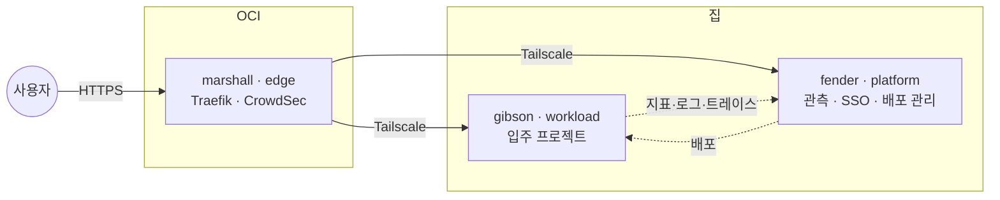

# jongmin-server-infra

홈서버 2대와 클라우드 VM 1대를 코드로 운영하는 레포.
서버마다 역할을 하나씩 맡기고, 입주 프로젝트에는 **서버만 빌려준다**.

> 서버가 1대에서 3대로 늘면서 구조를 다시 잡는 중이다.
> 지금 운영 중인 옛 구조와 새 구조가 레포에 함께 있다. 상태는 [docs/architecture.md](docs/architecture.md)의 상태표를 본다.

## 구성



| 서버 | 역할 | 주요 구성 |
|---|---|---|
| `marshall` | 인터넷 진입점 | Traefik v3, CrowdSec, blackbox exporter |
| `gibson` | 입주 프로젝트 실행 | 프로젝트별 compose, DB 백업 |
| `fender` | 플랫폼 | Prometheus · Loki · Tempo · Grafana, Keycloak, Komodo |

집 공유기에는 포트포워딩이 없다. 외부 트래픽은 marshall을 거쳐 Tailscale로만 집에 들어온다.

## 도구와 계층

| 계층 | 도구 | 위치 |
|---|---|---|
| 클라우드 자원·DNS·접근 규칙 | Terraform | `terraform/` |
| 서버 설정 | Ansible | `ansible/` |
| 띄울 서비스 | Docker Compose | `stacks/` |
| 배포 | Komodo | — |
| 검증 | GitHub Actions | `.github/workflows/` |

Kubernetes를 쓰지 않는 이유를 포함해, 고른 것과 고르지 않은 것의 이유는 [결정 기록](docs/adr/)에 있다.

## 문서

| 문서 | 내용 |
|---|---|
| [docs/architecture.md](docs/architecture.md) | 목표 구조, 구성 요소별 상태, 진행 단계 |
| [docs/adr/](docs/adr/) | 결정 기록 — 왜 이렇게 했나 |
| [docs/specs/](docs/specs/) | 작업 명세 — 완료 조건이 곧 테스트 |
| [docs/tenants.md](docs/tenants.md) | 입주 프로젝트 규칙 |
| [AGENTS.md](AGENTS.md) | AI 에이전트와 기여자를 위한 작업 규칙 |

## 일하는 방식

1. 작업마다 [명세](docs/specs/)를 쓴다. 완료 조건은 **서버 밖에서 관찰할 수 있는 결과**로 적는다.
2. 고치기 전에 그 검사가 실패하는 것을 확인한다.
3. dry-run 결과를 검토하고 적용한다.
4. 검사가 통과하고, 한 번 더 적용했을 때 변경이 없으면 끝이다.

전환은 새것을 옆에 세우고, 검증하고, 넘긴 뒤, 옛것을 지우는 순서로 한다.

## 레포 구조

```
AGENTS.md        작업 규칙 (안내판)
docs/            구조, 결정 기록, 명세, 입주 규칙
ansible/         서버 설정 (새 구조)
stacks/          서버별 compose
terraform/       OCI, Cloudflare DNS, Tailscale 접근 규칙
tenants/         프로젝트별 정책 파일
policy/          배포 전 검사
roles/ playbooks/ inventory/ ansible.cfg    옛 구조 — 전환이 끝나면 삭제
```

## 옛 구조 실행 (전환 완료 전까지)

```bash
ansible-galaxy collection install -r requirements.yml
ansible-playbook playbooks/site.yml --check --diff
```
