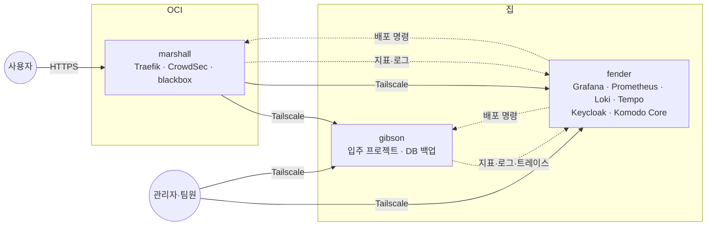

# 아키텍처

목표 구조와 구성 요소별 진행 상태. 결정의 이유는 [adr/](adr/)에 있다.

## 왜 바꾸는가

서버가 1대(Ryzen)에서 3대로 늘었다. 한 대에 프록시·앱·관측·관리 도구가 모두 얹혀 있던 구조를,
**서버마다 용도와 역할이 하나씩**인 구조로 정리한다. 그 과정에서 쓰지 않는 것을 덜어 낸다.

## 서버와 역할

| 서버 | 위치 | 신뢰 구역 | 역할 | 접근 |
|---|---|---|---|---|
| `marshall` | OCI Always Free VM | edge | 인터넷 진입점: 프록시, 침입 차단, 외부 점검 | 인터넷(80/443) |
| `gibson` | 집 (Ryzen) | workload | 입주 프로젝트 실행, DB 백업 | Tailscale만 |
| `fender` | 집 (N100) | platform | 관측, SSO, 배포 관리 | Tailscale만 |

원칙 두 가지([ADR 0002](adr/0002-trust-zones-and-state-placement.md)):

- **신뢰 구역을 섞지 않는다.** 인터넷에 열린 서버, 팀원이 쓰는 서버, 관리자만 쓰는 서버를 분리한다.
- **상태는 집에 둔다.** DB·지표·계정 데이터는 집 서버에. marshall은 언제든 다시 만들 수 있어야 한다.

집 공유기에는 포트포워딩을 두지 않는다. 외부 트래픽은 marshall을 거쳐 Tailscale로만 집에 들어온다.

## 계층

| 계층 | 도구 | 관리 대상 | 실행 위치 |
|---|---|---|---|
| 클라우드 | Terraform | OCI VM, Cloudflare DNS, Tailscale 접근 규칙 | 관리자 Mac |
| 서버 | Ansible | 계정, SSH, 방화벽, Docker, Tailscale, Komodo Periphery | 관리자 Mac |
| 서비스 정의 | compose 파일 | 무엇을 어떤 설정으로 띄울지 | 이 레포 `stacks/` |
| 배포 | Komodo | compose를 서버에 적용 | fender(Core) → 각 서버(Periphery) |
| 검증 | GitHub Actions | lint, 비밀값 검사, 형식 검사 | GitHub (배포는 하지 않음) |

입주 프로젝트는 **자기 레포의 compose 파일**로 배포한다. 이 레포는 서버와 규칙만 제공한다
([tenants.md](tenants.md)).

## 구성 요소 상태

상태: `운영`(새 구조로 동작) · `옛 구조`(동작 중이나 전환 대상) · `예정` · `제거 예정`

| 구성 요소 | 목표 위치 | 상태 | 비고 |
|---|---|---|---|
| Traefik v3 | marshall | 옛 구조 (gibson) | 파일 방식 라우트로 전환 |
| CrowdSec (+AppSec) | marshall | 예정 | fail2ban을 대체 |
| blackbox exporter | marshall | 예정 | 외부 관점 점검 |
| Prometheus·Loki·Tempo·Grafana | fender | 옛 구조 (gibson) | |
| Alloy (수집 에이전트) | 세 서버 | 예정 | |
| Keycloak | fender | 예정 | 첫 연결 대상은 Grafana |
| Komodo Core / Periphery | fender / 세 서버 | 예정 | Portainer를 대체 |
| DB 백업 | gibson → 외부 저장소 | 예정 | |
| Tailscale 접근 규칙 | Terraform | 옛 구조 (수동) | 서버명 태그, 기본 차단 |
| Portainer·Homepage·Glances | — | 제거 예정 | Komodo·Grafana로 대체 |
| Datadog 에이전트 | — | 제거 예정 | |
| cloudflare-ddns | — | 제거 예정 | DNS가 marshall로 넘어간 **뒤에** 제거 |
| 옛 `roles/`·`playbooks/`·`inventory/` | — | 옛 구조 | 전환 완료 후 삭제 |

## 진행 단계

진행은 GitHub 마일스톤과 이슈로 추적한다. 이 문서의 상태표는 단계가 끝날 때 갱신한다.

| 단계 | 내용 | 끝났다는 기준 |
|---|---|---|
| 0 | 현재 구조의 급한 보완 | 비공개 목록의 항목이 모두 닫힘 |
| 1 | 레포 개편 | 새 Ansible 뼈대·CI·배포 전 검사가 레포에서 통과 |
| 2 | fender (platform) | 관측·Keycloak·Komodo가 fender에서 동작 |
| 3 | marshall (edge) | 외부 트래픽이 marshall을 거치고 집 포트포워딩 0 |
| 4 | gibson (workload) | 입주 프로젝트가 Komodo로 배포, 옛 구조 삭제 |

각 단계는 **새것을 옆에 세우고 → 검증하고 → 전환하고 → 옛것을 지우는** 순서로 진행한다.
단계 사이에는 서비스가 계속 동작해야 한다.

## 서버를 추가할 때

역할 그룹에 서버를 넣는 것으로 끝나게 설계한다. 고칠 곳은 네 군데다.

1. `terraform/` — 클라우드 서버라면 서버 목록에 한 줄, Tailscale 태그 추가
2. `ansible/inventory/hosts.yml` — 역할 그룹에 호스트 추가, 필요하면 `host_vars/<서버>/`
3. `stacks/<서버>/` — 그 서버에 띄울 compose
4. 이 문서의 "서버와 역할" 표

역할 그룹(`edge`/`workload`/`platform`)에 속하지 않는 새로운 용도라면 그룹을 추가하고 ADR을 쓴다.
호스트명은 기타 브랜드에서 고른다.

## 옛 문서

개편 전 가이드(Traefik·Portainer·모니터링·CD 스크립트 등)는 옛 구조를 설명하므로 삭제했다.
필요하면 git 이력에서 본다: `git show a2bf328:docs/<파일명>`.
